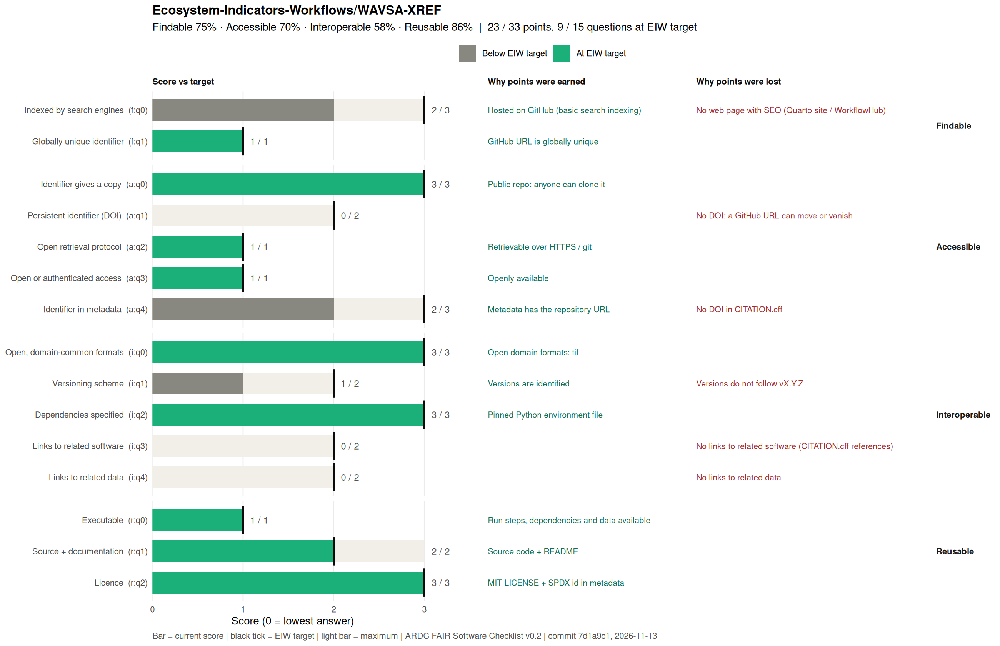

<!-- README.md is generated from README.qmd. Please edit that file -->

# Cross-referencing Western Australia’s pre-European vegetation system-association units to the IUCN Global Ecosystem Typology: 90m Best-Candidate Spatial Synthesis

**Version:** 0.1.0  
**Release Date:** 2026-11-14  
**Dataset License:** [CC BY
4.0](https://creativecommons.org/licenses/by/4.0/) **Code License:**
MIT  
**Workflow Repository:**
<https://github.com/Ecosystem-Indicators-Workflows/WAVSA-XREF>

> *Note: This `README.md` is dynamically generated from
> [`README.qmd`](README.qmd) by inspecting the output GeoTIFFs and CSV
> tables. To update all statistics after regenerating the data, run
> `quarto render output-best-candidate/README.qmd`.*

------------------------------------------------------------------------

## Authors & Contributors

- **José R. Ferrer-Paris**(ORCID:
  <https://orcid.org/0000-0002-9554-3395>) — Centre for Ecosystem
  Science, UNSW Sydney; IUCN Commission on Ecosystem Management
- **Mark G. Tozer** — Centre for Ecosystem Science, UNSW Sydney
- **David Keith** — Centre for Ecosystem Science, UNSW Sydney; IUCN
  Commission on Ecosystem Management

**Author Contributions:** MGT led the expert elicitation process. MGT
and DAK contributed membership tables for cross-referencing. JRFP led
the technical documentation and synthesis workflow. JRFP, EG, and ARS
contributed scripts for data preparation, validation, analysis, and
spatial output generation.

<!-- FAIR:START -->
## FAIR assessment

 

**23 / 33 points · 9 / 15 questions at EIW target** · not yet at EIW minimum

| Principle | Score | EIW target |
|---|---|---|
| Findable | 3 / 4 (75%) | 4 / 4 |
| Accessible | 7 / 10 (70%) | 10 / 10 |
| Interoperable | 7 / 12 (58%) | 12 / 12 |
| Reusable | 6 / 7 (86%) | 6 / 7 |

Gaps to close (6)

- **f:q0 Indexed by search engines** (2 / 3): No web page with SEO (Quarto site / WorkflowHub)
- **a:q1 Persistent identifier (DOI)** (0 / 2): No DOI: a GitHub URL can move or vanish
- **a:q4 Identifier in metadata** (2 / 3): No DOI in CITATION.cff
- **i:q1 Versioning scheme** (1 / 2): Versions do not follow vX.Y.Z
- **i:q3 Links to related software** (0 / 2): No links to related software (CITATION.cff references)
- **i:q4 Links to related data** (0 / 2): No links to related data

Updated 2026-11-13 from commit `7d1a9c1` by `.fair/fair_check.R`. Edit `.fair/fair-checklist.yml`, not this block.
<!-- FAIR:END -->
